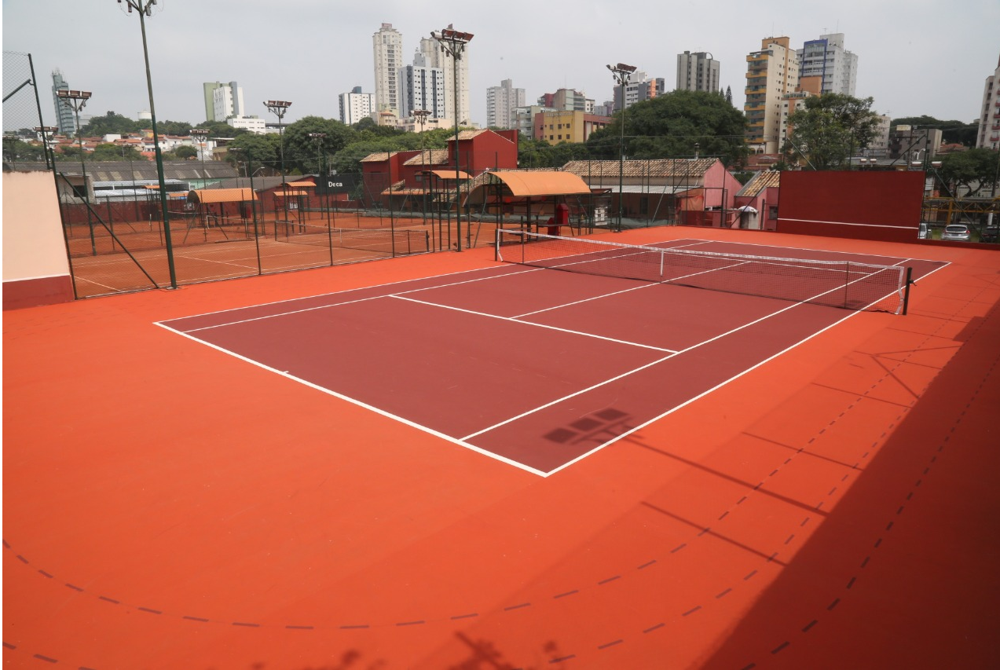
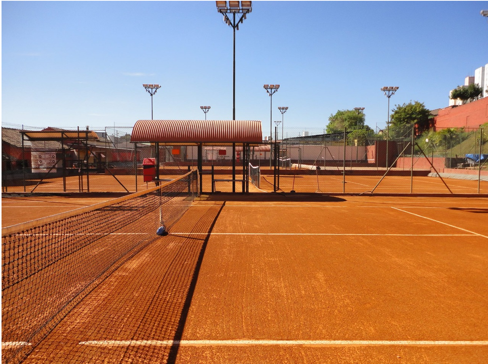
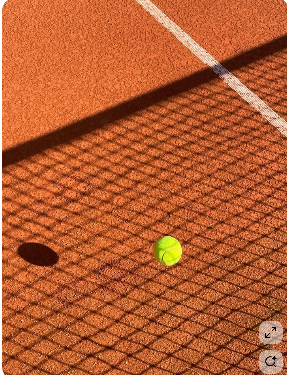
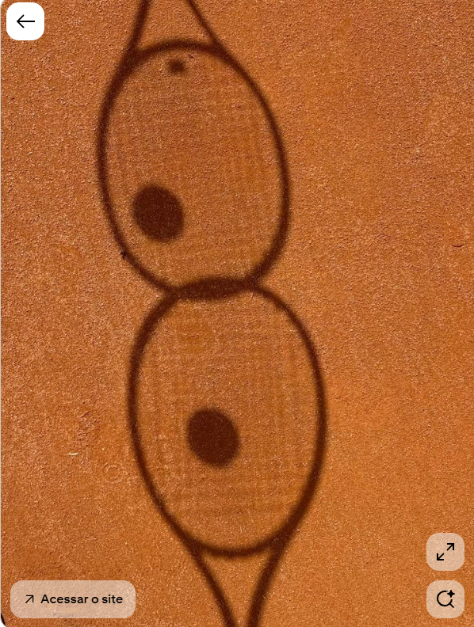
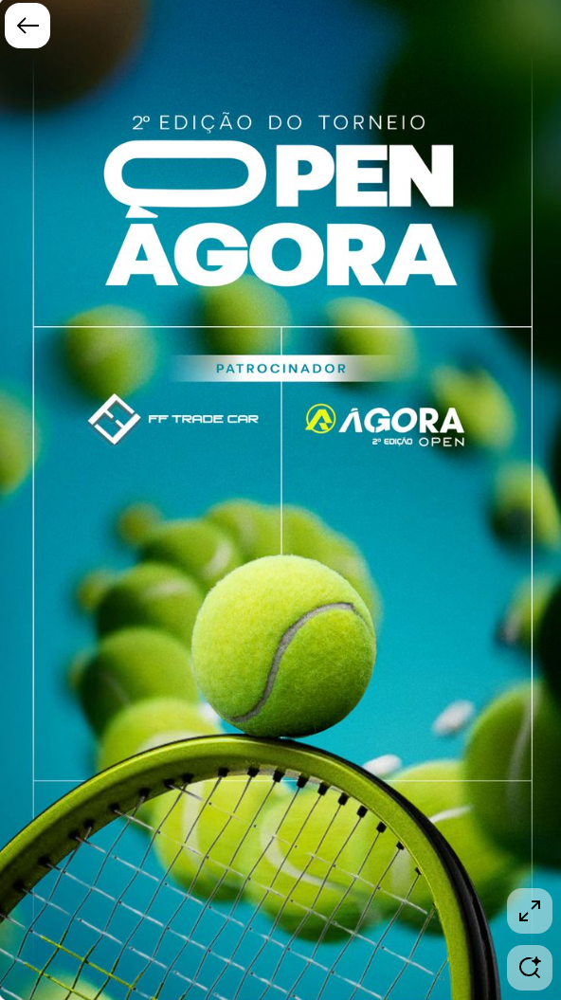
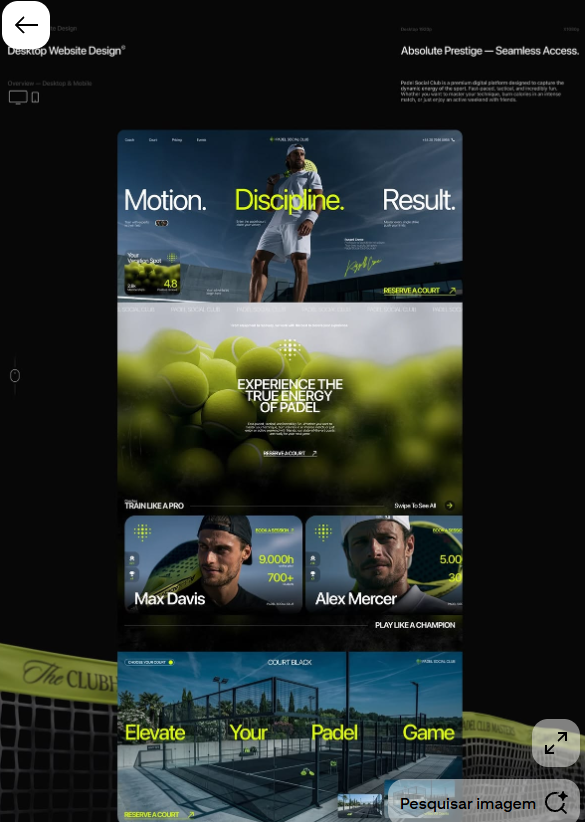
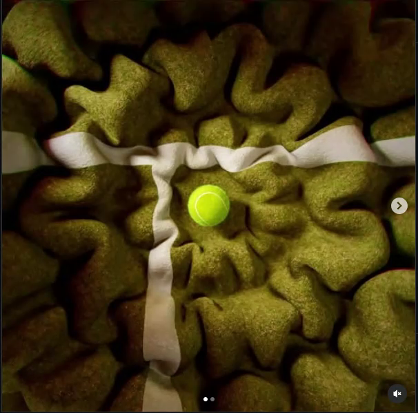
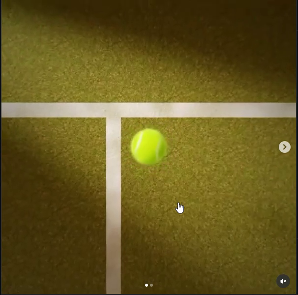
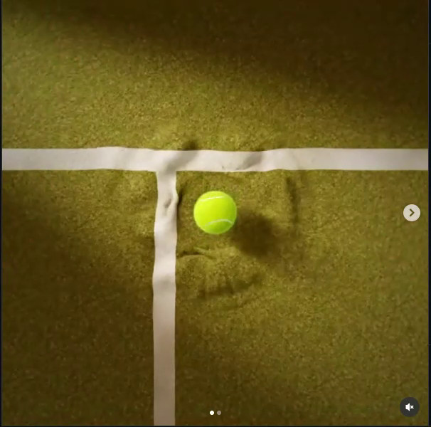

# Prompt: novo site da Red Tennis (MVP)

> **Como usar**
> 1. Descompacte o .zip e coloque a pasta `red-tennis-novo-site/` numa pasta vazia, que vai virar o projeto.
> 2. Abra o Claude Code nessa pasta.
> 3. Escreva: **"Leia PROMPT-CLAUDE-CODE.md e ANALISE-SITE-ATUAL.md, olhe todas as imagens em referencias/ e execute o prompt."**
>
> Tudo abaixo da linha é o prompt.

---

## 0. Papel e objetivo

Você é um time de duas pessoas: um **diretor de arte sênior** que já fez sites para marcas esportivas premium (pense em estúdios editoriais, não em templates) e um **engenheiro front-end sênior** obcecado por detalhe, performance e acessibilidade.

Vamos construir o **MVP do novo site da Red Tennis**, academia de tênis com quadras de saibro, quadra rápida, paredão e squash no Rudge Ramos, em São Bernardo do Campo (SP). O site vai ser apresentado amanhã ao dono da Red, dentro de uma proposta de **fidelização de alunos**. Ele precisa parecer o trabalho de um estúdio de design gráfico, não um site gerado por IA.

Leia `ANALISE-SITE-ATUAL.md` antes de começar: ali estão os dados reais da Red e os problemas do site atual que este projeto resolve.

## 1. Antes de escrever código

1. **Leia o site atual** em http://redtennis.com.br/, http://redtennis.com.br/aulas.php e http://redtennis.com.br/locacao.php (use WebFetch ou `curl`). Extraia textos, preços, horários, nomes de professores, tipos de aula, número de quadras e qualquer dado real. Se não conseguir acessar, siga com os dados de `ANALISE-SITE-ATUAL.md`.
2. Todo dado que você não conseguir confirmar vira um valor de exemplo plausível, marcado no arquivo de conteúdo com o comentário `// CONFIRMAR com a Red`. Nunca use lorem ipsum.
3. **Olhe cada imagem em `referencias/`** (abra os arquivos) e escreva, em `docs/direcao-de-arte.md`, o que você extraiu de cada uma: cor, textura, enquadramento, tipografia, ritmo. Só depois comece o design system.

## 2. As referências

### Fotos atuais da Red (usar no site, com tratamento)

| | |
|---|---|
|  |  |
| `01-quadra-rapida.png`: quadra rápida bordô com entorno laranja, paredão ao fundo, prédios do Rudge Ramos. | `02-quadras-saibro.png`: quadras de saibro com refletores, cobertura e rede em primeiro plano. |

São fotos amadoras e de baixa resolução (cerca de 1280 px de largura). Use-as **com tratamento**: recorte forte, um leve ajuste de cor quente, grão fino por cima (overlay SVG de ruído com opacidade ~6%) e nunca em tela cheia sem um véu escuro. O objetivo é que pareçam frames de uma mesma campanha. Prepare também *slots* nomeados para as fotos da sessão profissional futura (ver seção 9).

### Inspiração (não copiar, extrair linguagem)

| | | |
|---|---|---|
|  |  |  |
| **03 · Bola no saibro.** Luz dura de fim de tarde, a sombra da rede vira uma trama diagonal sobre o saibro. Um único ponto verde-limão num campo laranja. **Leve daqui:** a sombra da rede como textura gráfica e o contraste laranja x limão usado com parcimônia. | **04 · Sombra de raquetes.** Silhueta orgânica sobre textura de saibro, quase abstrata. **Leve daqui:** formas grandes de sombra como elemento de composição em seções de respiro. | **05 · Pôster de torneio.** Tipografia display extra larga em caixa alta, linhas finas da quadra dividindo o layout em grade, bola em foco com fundo desfocado. **Leve daqui:** as linhas da quadra como grid visível do site e a tipografia larga para títulos de evento. |

**06 · Layout editorial escuro ("Motion. Discipline. Result.").** Fundo quase preto, uma palavra em verde-limão no meio de um título de três palavras, fotos de atleta com contraste alto, faixa marquee com o nome do clube, cards de professor com dados (horas de quadra, alunos), CTA "Reserve a court" com seta diagonal. **Leve daqui:** a estrutura de título em três tempos, o uso de números como prova, o contraste escuro x limão. **Não copie** frase, layout nem fotos.

**07 · Vídeo `07-video-superficie.mp4`** (7 s, em loop). Animação 3D vista de cima: a superfície da quadra se amassa como tecido e volta a ficar lisa, com a bola parada no cruzamento de duas linhas brancas. Frames principais:

|  |  |  |
|---|---|---|
| Superfície amassada | Superfície lisa, luz rasante | Ondulação saindo da bola |

**Leve daqui:** a ideia de **superfície que reage**. Use no hero e nas transições: a textura de saibro que se deforma levemente com o cursor/scroll (veja seção 6), linhas de quadra que "se desenham" e um pulso de onda quando a bola "quica" num CTA.

## 3. Conceito criativo

**"Feito no saibro."** A Red é a casa do tênis de saibro no ABC. O site fala como um clube, não como uma empresa: frases curtas, segura, com orgulho do lugar.

Três ideias visuais guiam tudo:

1. **A quadra é o grid.** Linhas finas (1 px, cor cal) atravessam o layout como linhas de quadra: dividem colunas, emolduram seções, cruzam em "T" onde há algo importante. Use-as de verdade como estrutura, não como decoração solta.
2. **Saibro, bordô e uma bola.** Laranja de saibro e o bordô da quadra rápida como campos de cor grandes; o verde-limão aparece **só** como a bola: um ponto, uma palavra, um botão principal. Se o limão estiver em mais de ~5% da tela, está errado.
3. **Luz dura e sombra.** Sombras de rede e de raquete (geradas em SVG, a partir das referências 03 e 04) entram como texturas de seção.

## 4. Design system

Crie `src/styles/tokens.css` com tudo como variáveis CSS e use só os tokens.

### Cores

| Token | Hex | Uso |
|---|---|---|
| `--saibro` | `#C2552B` | Campo de cor principal, fundos de seção, ilustrações |
| `--saibro-escuro` | `#8E3A1C` | Sombras, hover sobre saibro |
| `--bordo` | `#6E1F1F` | Cor institucional da Red (quadra rápida), blocos de destaque, rodapé |
| `--grafite` | `#141210` | Fundo das seções escuras (não use preto puro) |
| `--cal` | `#F1ECE3` | Fundo claro e linhas de quadra (o branco do site é cal, nunca `#FFF`) |
| `--areia` | `#D9CBB6` | Texto secundário sobre escuro, divisores sutis |
| `--bola` | `#D4F03C` | Acento único: CTA principal, uma palavra por título, ponto da bola |

Garanta contraste AA. Texto sobre `--saibro` é `--cal` ou `--grafite`, nunca limão.

### Tipografia (Google Fonts, `next/font`)

- **Display:** *Archivo* (eixo de largura 125, peso 800–900), caixa alta, entrelinha 0.9, tracking −1%. Para títulos de seção e números grandes. É a voz do pôster (referência 05).
- **Editorial:** *Instrument Serif* itálico, só para uma palavra ou frase curta de contraste dentro de um título ("Feito *no saibro*.") e para citações.
- **Texto:** *Inter Tight* 400/500, 16–18 px, entrelinha 1.55, largura máxima de 62 caracteres.
- **Dados:** *JetBrains Mono* 500, caixa alta, tracking +8%, 11–12 px: rótulos, horários, preços, numeração de seções ("01 / AULAS").

Escala tipográfica fluida com `clamp()`: o título do hero vai de ~56 px no celular a ~176 px no desktop.

### Grid, espaço e forma

- Grid de 12 colunas, margem lateral de 24 px no mobile e 48–64 px no desktop, largura máxima de 1440 px.
- Espaçamento em escala de 8 px. Seções com 120–200 px de respiro vertical no desktop.
- Cantos **retos** (raio 0) como padrão. Raio total só em elementos que são "bola" (o ponto de status, o botão redondo da seta).
- Nada de sombras de caixa genéricas. Profundidade vem de sobreposição, cor e foto.

### Movimento

- Biblioteca: **Motion** (framer-motion) + **Lenis** para scroll suave.
- Curva padrão `cubic-bezier(0.22, 1, 0.36, 1)`, 600–900 ms em entradas.
- Títulos entram por linha com máscara (o texto sobe de dentro de um recorte), não por fade genérico.
- Linhas de quadra se desenham com `stroke-dashoffset` quando entram na tela.
- Respeite `prefers-reduced-motion`: tudo vira estático.

## 5. O que é proibido (cara de "vibe code")

- Gradientes roxo/azul ou qualquer gradiente decorativo de fundo; glassmorphism; brilho neon.
- Emojis em qualquer lugar. Ícones genéricos de biblioteca em todo card (no máximo uma família, *Phosphor* traço fino, usada pouco).
- Grade de 3 ou 4 cards iguais com ícone + título + texto. Quando houver lista de itens, varie: tabela editorial, lista numerada com linhas, layout assimétrico, card grande + pequenos.
- Seção hero centralizada com título, subtítulo e dois botões lado a lado sobre foto de banco.
- Textos vazios de IA ("Eleve seu jogo ao próximo nível", "Descubra", "Experiência única", "Bem-vindo"). Escreva como um professor de tênis falaria com o aluno.
- Fotos de banco de imagem com pessoas genéricas. Use as fotos da Red, as texturas geradas e placeholders elegantes (bloco de cor com legenda em mono "FOTO · Professor em quadra, luz de fim de tarde").
- Cantos arredondados de 16 px em tudo, `shadow-lg` em tudo, botões em pílula com gradiente.
- Contadores animados de "+1000 clientes felizes" sem dado real.

## 6. Arquitetura de páginas e seções

Stack: **Next.js 15 (App Router) + TypeScript + Tailwind CSS v4 + Motion + Lenis**, exportação estática (`output: 'export'`), pronto para publicar na Vercel. Todo o conteúdo editável (preços, horários, professores, planos, torneios, contato) fica em **`src/content/red.ts`**, uma única fonte de verdade, para a Red editar sem mexer no layout.

### Elementos globais

- **Header** fino sobre o hero, logotipo tipográfico "RED TENNIS" (Archivo larga + um ponto limão no lugar de algum detalhe, como a bola). Menu: Aulas, Quadras, Clube Red, Torneios, Sobre, Contato. À direita, botão "Agendar aula" (limão). No scroll, o header vira barra `--grafite` com 64 px.
- **Menu mobile** em tela cheia `--bordo`, itens em Archivo gigante, numerados em mono, com horário de hoje e WhatsApp no rodapé do menu.
- **Botão de WhatsApp fixo** no mobile (barra inferior com dois botões: "Aula experimental" e "Reservar quadra"), cada um abrindo `wa.me/5511984432672` com mensagem pronta diferente.
- **Rodapé** `--bordo`: endereço, mapa estático estilizado (SVG do quarteirão com o pino-bola, não um iframe cru), horários por dia, telefone, Instagram, selo "Aceitamos TotalPass", e um "RED TENNIS" enorme cortado na base da página.

### Home (`/`)

1. **Hero "superfície".** Fundo de textura de saibro (gerada com SVG `feTurbulence` + cor `--saibro`, sem imagem pesada). Sombra diagonal da rede passando por cima (padrão SVG). Título em três tempos, em Archivo larga: **"SAIBRO. TÉCNICA. *Resultado.*"** com a última palavra em limão ou em Instrument Serif. Uma bola (círculo limão com a curva de costura em SVG) parada no cruzamento de duas linhas de quadra. Interação inspirada no vídeo 07: ao mover o cursor (ou com o scroll no mobile), a textura se deforma levemente em volta do ponteiro (filtro SVG `feDisplacementMap` com escala animada) e, ao clicar na bola, sai uma onda circular. Abaixo do título: uma linha de dados em mono ("RUDGE RAMOS · SBC — SAIBRO · QUADRA RÁPIDA · PAREDÃO · SQUASH — ABERTO HOJE ATÉ 22H") e o CTA principal "Agendar aula experimental ↗".
2. **Faixa marquee** cal sobre grafite: "AULAS · LOCAÇÃO · TORNEIOS · CLUBE RED · TOTALPASS ·" em loop lento.
3. **Manifesto.** Texto grande em duas colunas assimétricas sobre `--cal`: um parágrafo curto sobre a Red (anos de história `// CONFIRMAR`), a foto do saibro tratada à direita, cortada em formato vertical, com legenda em mono.
4. **Aulas.** Não use cards iguais. Faça uma **tabela editorial** com linhas de quadra: cada linha é um programa (Kids / bola vermelha, Iniciante adulto, Intermediário, Competição, Particular), com colunas "para quem", "frequência", "duração", "a partir de R$". Ao passar o mouse, a linha preenche de `--saibro` e mostra uma foto pequena seguindo o cursor. CTA para `/aulas`.
5. **Quadras.** Seção escura dividida ao meio pela linha central de uma quadra desenhada: à esquerda **Saibro** (foto 02), à direita **Quadra rápida** (foto 01), cada lado com 3 dados técnicos em mono (número de quadras, iluminação, horário) e o botão "Reservar". Arrastar a linha central compara os dois pisos (efeito antes/depois).
6. **Clube Red (fidelização).** Esta é a seção mais importante para a proposta. Fundo `--bordo`. Título "O CLUBE *de quem joga toda semana.*" Três planos mensais apresentados como **ingressos/cartões de sócio** com perfuração lateral e numeração, não como pricing cards SaaS: *Clube Red Saibro* (aulas em grupo 2x por semana), *Clube Red Pro* (grupo + 1 particular por mês + desconto em locação), *Clube Red Família*. Benefícios em lista numerada: prioridade de horário, ranking interno, torneio mensal, desconto em encordoamento, indicação que vale aula grátis. Preços `// CONFIRMAR`.
7. **Professores.** Faixa horizontal com scroll arrastável: retrato vertical em P&B tratado com duotone saibro, nome em Archivo, e dados em mono (anos de quadra, certificação, especialidade). Placeholders elegantes se não houver foto.
8. **Torneios e agenda.** Pôster do próximo torneio interno no estilo da referência 05 (tipografia larga, linhas da quadra como grid, data gigante) e, ao lado, a agenda dos próximos 3 eventos em lista com data em mono.
9. **Prova social.** Dois ou três depoimentos grandes em Instrument Serif, com nome, tempo de Red e nível. Marque como `// CONFIRMAR: coletar depoimentos reais`.
10. **Visite a Red.** Endereço, horários de hoje destacados (calcule o dia atual no fuso America/Sao_Paulo e mostre "Aberto agora" com ponto limão pulsando ou "Fechado, abre às 7h"), mapa SVG, botões "Como chegar" (Google Maps) e WhatsApp.
11. **CTA final** em tela cheia saibro com a sombra das raquetes (ref. 04) e o título "A QUADRA ESTÁ *pronta.*"

### Páginas internas

- **`/aulas`**: detalhes de cada programa, metodologia em 4 etapas (linha do tempo horizontal desenhada como uma quadra vista de cima), perguntas frequentes em acordeão com linhas, formulário de aula experimental (nome, idade, nível, melhor horário) que monta a mensagem e abre o WhatsApp.
- **`/quadras`**: os pisos, a estrutura (vestiário, estacionamento, Wi-Fi, paredão, squash), tabela de preços de locação por horário (diurno/noturno, semana/fim de semana) e um **mock de reserva**: grade da semana com horários livres/ocupados (dados falsos em `red.ts`), ao escolher um horário abre o WhatsApp com dia e hora preenchidos. Deixe a interface pronta para ligar num sistema de reservas depois.
- **`/clube-red`**: planos completos, comparativo em tabela, programa de indicação, regras do ranking interno, perguntas frequentes.
- **`/torneios`**: próximos eventos, resultados e ranking interno (tabela com posição, nome, pontos, setinha de subida/descida).
- **`/sobre`**: história, linha do tempo, equipe, estrutura.
- **`/contato`**: tudo de contato e formulário.
- **`404`** com uma bola fora da linha: "Essa foi pra fora."

## 7. Texto (copy)

- Português do Brasil, tom de clube: direto, confiante, caloroso. Frases curtas. Verbo no imperativo nos CTAs ("Agende", "Reserve", "Venha jogar").
- Escreva todo o texto real do site. Nada de lorem ipsum, nada de frase genérica. Use os termos do tênis (saibro, slice, paredão, bola vermelha, ranking, tie-break) com naturalidade.
- Mensagens de WhatsApp prontas, por exemplo: "Olá, Red! Vim pelo site e quero agendar uma aula experimental. Meu nome é ___ e meu nível é ___."

## 8. Qualidade técnica

- **Mobile first.** Teste em 360, 390, 768, 1024, 1440 e 1920 px. Sem rolagem horizontal. Alvos de toque ≥ 44 px.
- **Performance:** Lighthouse ≥ 95 em Performance, Acessibilidade, Boas práticas e SEO no mobile. Imagens com `next/image` em AVIF/WebP, `sizes` corretos, hero sem imagem pesada (textura em SVG), fontes com `display: swap` e subset latin.
- **Acessibilidade:** HTML semântico, foco visível (contorno limão de 2 px), navegação por teclado no menu, no comparador de quadras e no carrossel, `alt` descritivo em todas as fotos, contraste AA.
- **SEO local:** `metadata` por página com títulos do tipo "Aulas de tênis em São Bernardo do Campo | Red Tennis Rudge Ramos"; descrição única por página; JSON-LD `SportsActivityLocation` + `LocalBusiness` com endereço, telefone, horários e geo (-23.6704, -46.5616); `sitemap.xml`, `robots.txt`, Open Graph com imagem gerada (1200×630, no estilo do pôster), `lang="pt-BR"`, URL canônica.
- **Código:** componentes pequenos, sem dependências desnecessárias, sem `any`, ESLint limpo. Um `README.md` explicando como rodar, onde editar conteúdo (`src/content/red.ts`) e como publicar.

## 9. Fotografia: o que preparar para a sessão profissional

Crie `docs/briefing-fotos.md` com a lista de fotos que o site pede (o que, onde aparece, proporção, luz): bola na linha do saibro com sombra da rede ao fim da tarde; professor em ação de lado, com saibro levantando; detalhe de pés deslizando no saibro; retrato vertical de cada professor; crianças na bola vermelha; a quadra rápida vista de cima; a estrutura ao anoitecer com os refletores acesos. No código, cada um desses lugares usa um componente `<PhotoSlot name="..."/>` que mostra a foto atual tratada ou o placeholder elegante, para trocar depois só colocando o arquivo.

## 10. Processo de trabalho

1. Leia os arquivos e as imagens. Escreva `docs/direcao-de-arte.md` (análise das referências + conceito + tokens).
2. Monte o design system e uma página `/styleguide` com cores, tipografia, botões, linhas e texturas. Tire screenshot e critique antes de seguir.
3. Construa a home seção por seção. A cada 2 ou 3 seções, rode o site e tire screenshots com Playwright em 1440 px e 390 px.
4. **Autocrítica obrigatória** em cada rodada de screenshots. Pergunte: um diretor de arte aprovaria isto? Isso parece template? Há cards iguais repetidos? O limão está sobrando? A hierarquia lê em 3 segundos? O mobile está tão bom quanto o desktop? Corrija antes de avançar.
5. Faça as páginas internas, o SEO e a acessibilidade.
6. Rode `npm run build` e Lighthouse no mobile. Corrija até bater as metas.
7. No final, entregue: como rodar, a lista de tudo marcado `// CONFIRMAR com a Red` e sugestões do que mais fazer depois do MVP (reserva online integrada, área do aluno, pagamento recorrente do Clube Red).

**Critério de pronto:** se alguém olhar o site por 5 segundos e não conseguir dizer que ele foi feito sob medida para uma academia de tênis de saibro chamada Red, ainda não está pronto.
